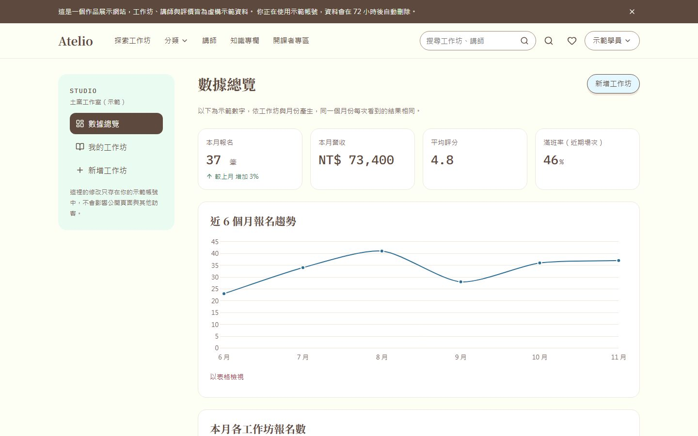
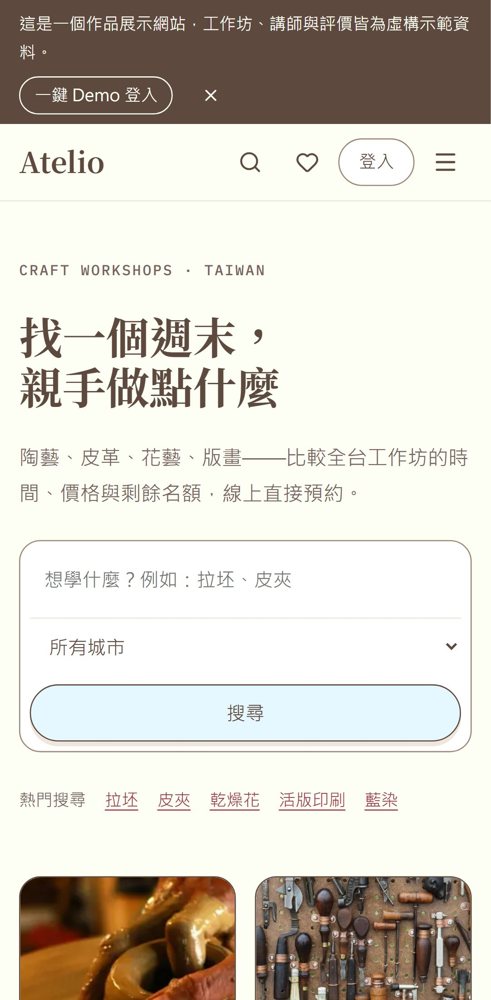

# Atelio｜設計與手作工作坊預約平台

探索、比較、預約陶藝、皮革、花藝、版畫等手作工作坊，並提供開課者管理課程與查看報名數據的 Studio 後台。

**線上展示**：<https://atelio-by-v.vercel.app/>　｜　**一鍵 Demo 登入**：免註冊，3 分鐘體驗完整流程

> ⚠️ 本專案為求職作品。所有工作坊、講師、評價與報名數據皆為**虛構示範資料**，網站上有明顯標示；全站預設 `noindex`，不會出現在搜尋結果中。使用者產生的資料會在 72 小時後自動刪除。


| 工作坊列表（篩選狀態同步至網址）              | Studio 數據總覽                        |
| --------------------------------------------- | -------------------------------------- |
|  |  |

| 手機版首頁                                                                | 手機版詳細頁                                                                  |
| ------------------------------------------------------------------------- | ----------------------------------------------------------------------------- |
|  |  |

---

## 功能

**學員端**

- 工作坊列表：關鍵字、分類、城市、價格、難度、日期篩選與排序、分頁；所有條件同步到網址，可直接分享
- 工作坊詳細頁：場次與即時剩餘名額、講師、評價、FAQ、相關課程
- 三步驟預約流程（場次 → 聯絡資料 → 確認），名額由伺服器驗證
- 會員中心：預約管理（修改人數、取消）、收藏、個人資料
- 分類／城市落地頁、講師頁、知識專欄、全站搜尋

**開課者端（Studio）**

- 數據總覽：本月報名、營收、滿班率，近 6 個月趨勢圖（附表格檢視，螢幕閱讀器可讀）
- 工作坊新增、編輯、上下架、刪除，修改只影響自己的示範帳號

---

## 技術亮點

| 主題               | 做法                                                                                                                                                   | 說明文件                                           |
| ------------------ | ------------------------------------------------------------------------------------------------------------------------------------------------------ | -------------------------------------------------- |
| **混合渲染**       | 依頁面性質選擇：內容頁預先產生、目錄頁 ISR（CDN 快取 1 小時）、會員與 Studio 頁 CSR                                                                    | [04-architecture](docs/04-architecture.md)         |
| **真正的後端 API** | Nitro REST API，分成 handler／service／repository 三層；Zod schema 前後端共用                                                                          | [10-api](docs/10-api.md)                           |
| **資料隔離**       | Upstash Redis，每個帳號的資料以 `user:{id}:*` 隔離並設 72 小時 TTL，訪客之間互不影響                                                                   | [04-architecture](docs/04-architecture.md) ADR-003 |
| **資安**           | CSP 全站以 hash 驗證內嵌腳本（`script-src` 無 `unsafe-inline`，ISR 快取頁也適用）、加密 Session Cookie、IDOR 防護、Origin 檢查、速率限制、請求大小限制 | [05-security](docs/05-security.md)                 |
| **無障礙**         | WCAG 2.2 AA：axe-core 自動檢測 0 違規、全流程可只用鍵盤完成、對話框焦點管理、色彩對比由測試把關                                                        | [06-design-system](docs/06-design-system.md)       |
| **SEO／GEO**       | 結構化資料（Course／CourseInstance、BreadcrumbList、FAQPage、BlogPosting、Person）、資料驅動的 sitemap、`llms.txt`；索引開關預設關閉                   | [11-seo-geo](docs/11-seo-geo.md)                   |
| **設計系統**       | DTCG 格式 Design Token 為唯一來源，SCSS 由測試確認同步；不使用 UI 套件與 Tailwind                                                                      | [06-design-system](docs/06-design-system.md)       |

---

## 品質指標（2026-11-20 實測，本機正式版建置）

| 項目                                  | 結果                                                           |
| ------------------------------------- | -------------------------------------------------------------- |
| 單元測試（Vitest）                    | 12 個檔案、220 個測試通過                                      |
| E2E 測試（Playwright，桌機＋手機）    | 預約流程、Studio、API 資安、SEO、無障礙、鍵盤操作              |
| 無障礙（axe-core，WCAG 2.2 AA）       | 公開頁面與登入後頁面皆 0 違規                                  |
| Lighthouse 行動版（無障礙／最佳做法） | 所有受測頁面 100／100，CLS 0                                   |
| Lighthouse 行動版（效能）             | 84–96（模擬 CDN 壓縮），詳見 [09-dev-log](docs/09-dev-log.md)  |
| 依賴弱點（npm audit）                 | 0 high／critical，評估見 [05-security](docs/05-security.md) §8 |

SEO 分數因刻意設定 `noindex` 而扣分，屬預期結果。

---

## 技術棧

Nuxt 4 · Vue 3 · TypeScript（strict）· Pinia · SCSS · Zod · Nitro · Upstash Redis · nuxt-auth-utils · nuxt-security · Chart.js · Vitest · Playwright · GitHub Actions · Vercel

刻意不使用 UI 套件、Tailwind、Axios，理由見 [04-architecture](docs/04-architecture.md)。

---

## 本機執行

需要 Node.js 22.22.3 以上（建議使用 `.node-version` 指定的 24）。

```bash
npm install
npm run dev          # http://localhost:3000
```

不需要任何帳號或環境變數：沒有設定 Upstash 時，資料改存在記憶體（重新啟動就清空）。需要的話，把 `.env.example` 複製成 `.env` 再填入。

| 指令                                 | 用途                                                     |
| ------------------------------------ | -------------------------------------------------------- |
| `npm run lint` / `npm run typecheck` | 程式碼檢查、型別檢查                                     |
| `npm test`                           | 單元測試                                                 |
| `npm run test:e2e`                   | E2E 測試（首次需執行 `npx playwright install chromium`） |
| `npm run test:a11y`                  | 只跑無障礙與鍵盤操作測試                                 |
| `npm run audit:lighthouse`           | Lighthouse 量測（需先啟動正式版建置，見腳本說明）        |

部署步驟見 [docs/12-deployment.md](docs/12-deployment.md)。

---

## 文件

| 文件                                                                            | 內容                             |
| ------------------------------------------------------------------------------- | -------------------------------- |
| [01-PRD](docs/01-PRD.md)                                                        | 產品需求、目標使用者、功能範圍   |
| [02-sitemap](docs/02-sitemap.md)                                                | 網站地圖與各頁渲染策略           |
| [03-user-flow](docs/03-user-flow.md)                                            | 使用者流程                       |
| [04-architecture](docs/04-architecture.md)                                      | 系統架構與技術決策（ADR）        |
| [05-security](docs/05-security.md)                                              | 威脅模型、資安控制措施與實測結果 |
| [06-design-system](docs/06-design-system.md)                                    | 設計系統、色彩與無障礙規範       |
| [07-wireframes](docs/07-wireframes.md) / [08-figma-spec](docs/08-figma-spec.md) | 線框稿與 Figma 建檔規格          |
| [09-dev-log](docs/09-dev-log.md)                                                | 各階段開發紀錄、問題與決策       |
| [10-api](docs/10-api.md)                                                        | REST API 規格                    |
| [11-seo-geo](docs/11-seo-geo.md)                                                | SEO 與生成式搜尋最佳化           |
| [12-deployment](docs/12-deployment.md)                                          | 部署與上線檢查                   |

---

## 圖片來源

工作坊照片皆為 CC0 或公眾領域（Public Domain Mark）授權，取自 [Openverse](https://openverse.org/)，作者與來源記錄在 [`shared/data/workshop-images.ts`](shared/data/workshop-images.ts)。
