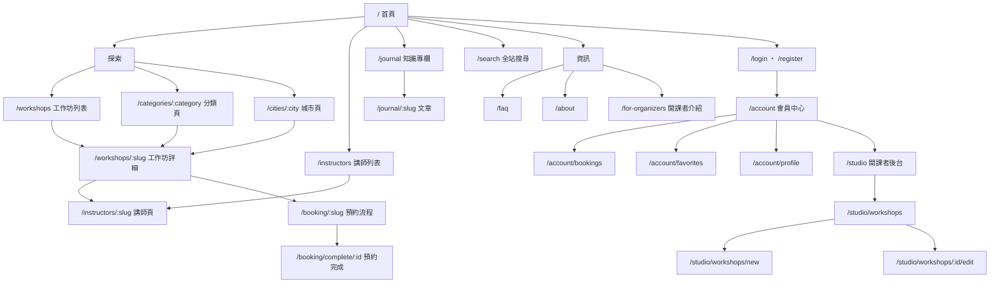

# Atelio 網站資訊架構與 Sitemap

> 版本：v0.1（Phase 1）

## 1. 資訊架構（IA）

## 2. 路由總表

渲染模式說明：
- **Prerender**：建置時產生靜態 HTML（最佳 SEO 與效能）。
- **ISR**：Vercel Incremental Static Regeneration，第一次請求時渲染並由 CDN 快取，定期重新產生（內容會變動但需被索引的頁面）。
- **SSR**：每次請求伺服器渲染。
- **CSR**：僅在瀏覽器渲染（會員、後台等私人頁面）。

| 路由 | 頁面 | 渲染 | 索引 | 結構化資料 |
| --- | --- | --- | --- | --- |
| `/` | 首頁 | ISR（Phase 4 由 Prerender 改為 ISR：近期場次依當下時間計算，prerender 會凍結在建置當天） | ✅ | `WebSite`（含 SearchAction）、`Organization` |
| `/workshops` | 工作坊列表 | SSR | ✅（僅無 query 版本） | `ItemList`、`BreadcrumbList` |
| `/workshops?…` | 篩選結果 | SSR | ❌ `noindex,follow`，canonical 指回 `/workshops` | — |
| `/categories/:category` | 分類落地頁 | ISR | ✅ | `CollectionPage`、`ItemList`、`BreadcrumbList` |
| `/cities/:city` | 城市落地頁 | ISR | ✅ | `CollectionPage`、`ItemList`、`BreadcrumbList` |
| `/workshops/:slug` | 工作坊詳細 | ISR | ✅ | `Course` + `CourseInstance`／`Event`、`AggregateRating`、`FAQPage`、`BreadcrumbList` |
| `/instructors` | 講師列表 | Prerender | ✅ | `ItemList` |
| `/instructors/:slug` | 講師頁 | ISR | ✅ | `Person`、`ProfilePage`、`BreadcrumbList` |
| `/journal` | 知識專欄 | Prerender | ✅ | `Blog` |
| `/journal/:slug` | 文章 | Prerender | ✅ | `Article`（含 author、dateModified）、`BreadcrumbList` |
| `/search` | 全站搜尋 | SSR | ❌ | — |
| `/faq` | 常見問題 | Prerender | ✅ | `FAQPage` |
| `/about` | 關於 | Prerender | ✅ | `AboutPage`、`Organization` |
| `/for-organizers` | 開課者介紹 | Prerender | ✅ | `WebPage` |
| `/login`、`/register` | 登入／註冊 | CSR | ❌ | — |
| `/booking/:slug` | 預約流程 | CSR | ❌ | — |
| `/booking/complete/:id` | 預約完成 | CSR | ❌ | — |
| `/account/**` | 會員中心 | CSR | ❌ | — |
| `/studio/**` | 開課者後台 | CSR | ❌ | — |
| 其他 | 404 | SSR（回傳 HTTP 404） | ❌ | — |

> 結構化資料的目的是幫助搜尋引擎與 AI **理解內容**，不保證出現複合式搜尋結果（Rich Results）。Google 會調整支援的類型（例如部分 Course 相關的複合式結果已被簡化或停用），Phase 5 實作時會以當下的 Google Search Central 文件與 Rich Results Test 為準重新確認。

> 為什麼列表篩選結果不索引？篩選組合數量龐大（分類 × 城市 × 價格 × 日期），全部索引會產生大量近似重複頁面、浪費檢索預算。改以「分類頁」「城市頁」這種有獨立介紹文字的落地頁承接搜尋流量。

## 3. URL 與 Slug 規範

- 全部小寫英文、以 `-` 連接，不使用中文 slug（避免分享時被編碼成 `%E9%99%B6…`）。
  - 例：`/workshops/wheel-throwing-basics-taipei`
- 資源層級清楚：`/{集合}/{slug}`，不超過兩層（會員與後台除外）。
- 結尾不加 `/`，伺服器統一將 `/workshops/` 301 轉址至 `/workshops`。
- 篩選使用 query string：`/workshops?category=ceramics&city=taipei&sort=price-asc&page=2`。
- slug 變更時保留舊 slug 301 轉址（資料模型保留 `previousSlugs` 欄位）。

### 分類 slug（初版）

| slug | 名稱 |
| --- | --- |
| `ceramics` | 陶藝 |
| `leathercraft` | 皮革 |
| `floral` | 花藝 |
| `printmaking` | 版畫・印刷 |
| `typography` | 字體・書法 |
| `woodworking` | 木工 |
| `textile` | 織品・染布 |
| `illustration` | 插畫・水彩 |

### 城市 slug（初版）

`taipei` 台北、`new-taipei` 新北、`taoyuan` 桃園、`taichung` 台中、`tainan` 台南、`kaohsiung` 高雄。

## 4. 主導覽與內部連結策略

- **Header**：探索工作坊、分類（Dropdown）、講師、知識專欄、開課者專區；右側為搜尋、收藏、會員。
- **Footer**：分類與城市連結（落地頁內部連結）、FAQ、關於、示範資料聲明。
- **詳細頁**：連到講師頁、分類頁、城市頁與 3–4 個相關工作坊。
- **文章**：在文中自然連結到相關分類頁與工作坊（不堆砌）。
- **Breadcrumb**：所有二層以上公開頁面顯示，並輸出 `BreadcrumbList`。
