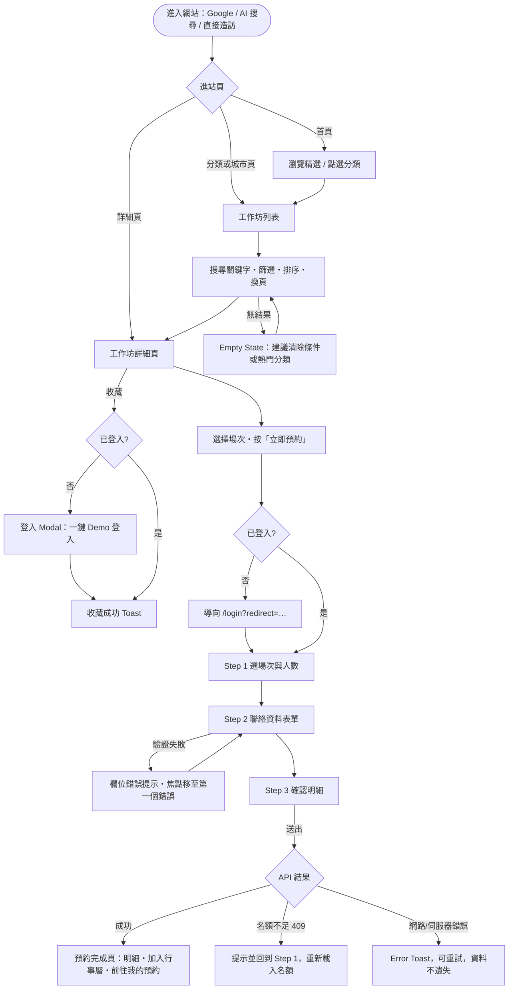
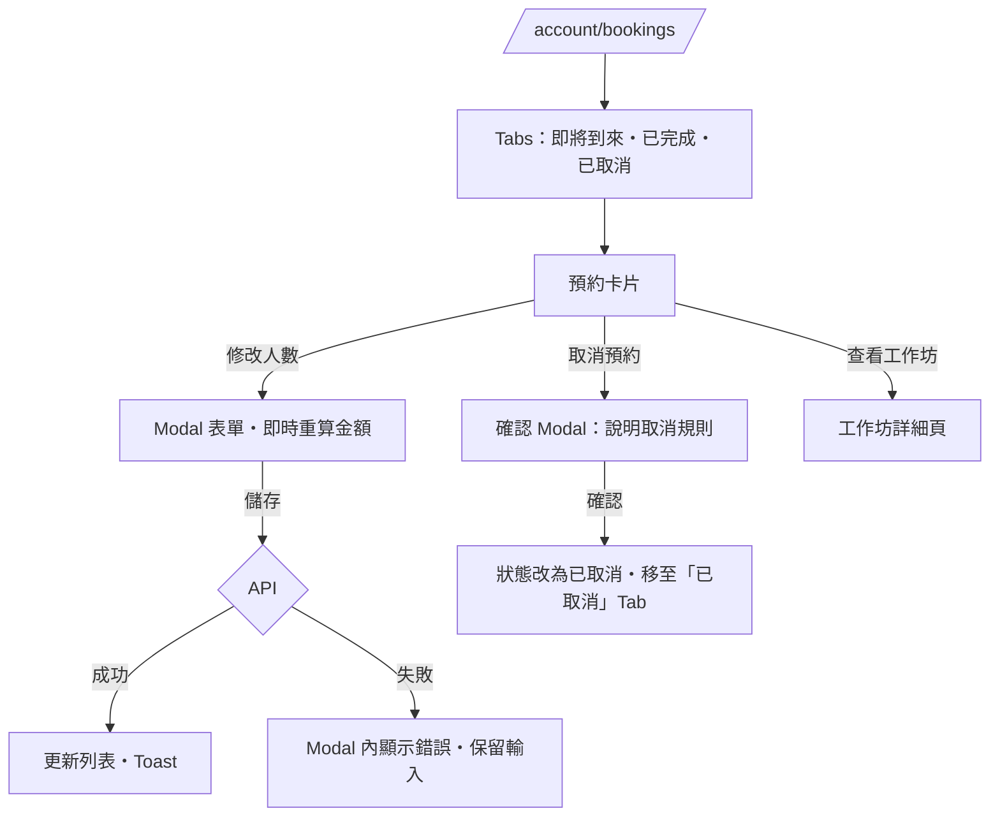
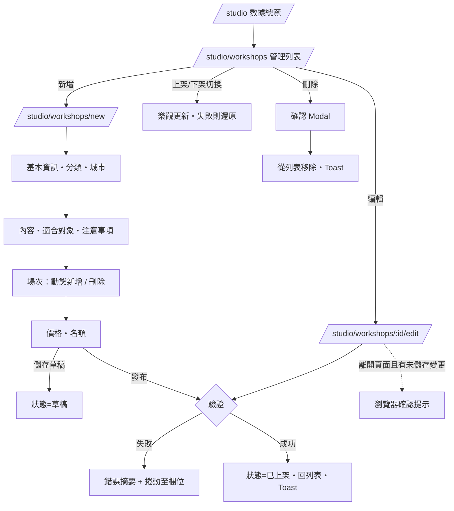

# Atelio 使用者流程（User Flow）

> 版本：v0.1（Phase 1）

## Flow 1：學員搜尋並預約工作坊（核心流程）

**設計重點**
- 未登入使用者可完整瀏覽，只有「收藏 / 預約」才需要登入，降低流失。
- 預約表單資料存在 Pinia，切換步驟或錯誤重試時不會遺失。
- 名額不足以 HTTP 409 回應，前端顯示具體原因，而不是通用錯誤。

## Flow 2：學員管理預約

## Flow 3：開課者新增並管理工作坊

## Flow 4：面試官快速體驗（3 分鐘路徑）

1. 首頁 Hero 下方「示範說明」區塊 → 點「一鍵 Demo 登入」。
2. 搜尋「陶」→ 篩選台北 → 進入詳細頁 → 預約。
3. 會員中心查看並取消預約。
4. 進入 Studio 查看圖表 → 新增一筆工作坊。

> 此路徑同時是 E2E 測試的主要腳本。

## 狀態對照表（所有資料區塊共用）

| 狀態 | 呈現 |
| --- | --- |
| Loading（首次） | Skeleton（與實際版面同尺寸，避免 CLS） |
| Loading（更新中） | 保留舊資料 + 頂部細進度條，避免畫面閃爍 |
| Empty | 插圖 + 說明 + 下一步行動按鈕 |
| Error | 錯誤說明 + 重試按鈕；表單錯誤則顯示於欄位 |
| Success（操作） | Toast，5 秒自動消失（滑鼠移入或聚焦時暫停，WCAG 2.2.1），可用關閉按鈕關閉 |
